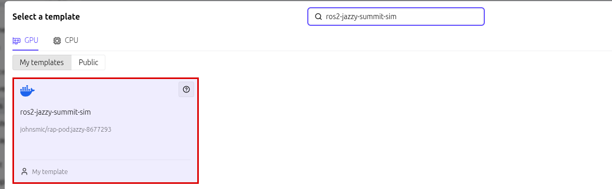
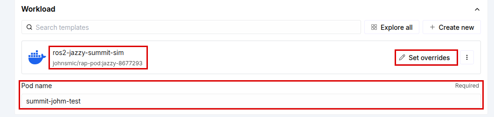
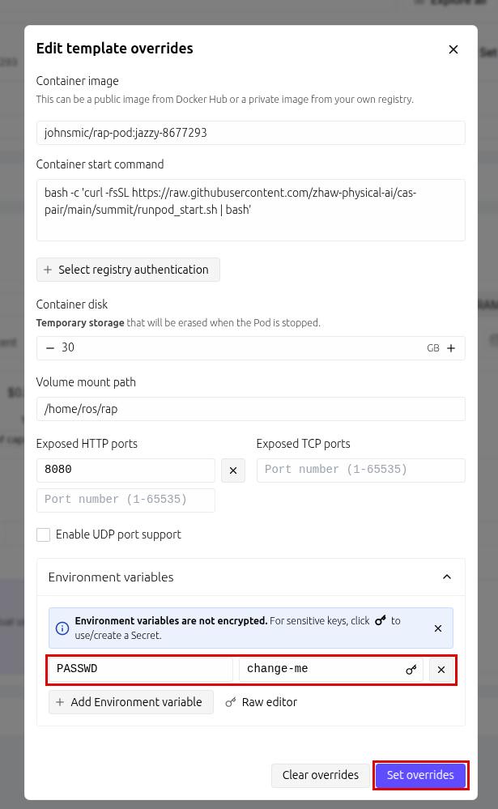
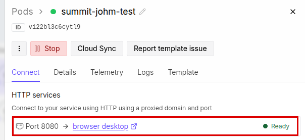

# Summit XL simulation

A Robotnik Summit XL (mobile base + UR5 arm) in Gazebo Harmonic, with Nav2 and MoveIt, on a
ROS 2 Jazzy desktop in your browser. No robot and no Jetson: it runs on a RunPod GPU pod.

## Open the desktop

1. Open the template, logged in to your own RunPod account, and click **Configure Pod**:
   https://console.runpod.io/hub/template/sef84j4t7b?ref=vc5f9d3q

   Or search for `ros2-jazzy-summit-sim` when you deploy a pod:

   

2. On the deploy page, give the pod a name and click **Set overrides** next to the template:

   

   Change `PASSWD` from `change-me` to your own password, then **Set overrides**:

   

   Deploy on any NVIDIA GPU. The first start takes a few minutes.

3. Under **Connect**, wait for **Ready** next to Port 8080, click **browser desktop**, then
   **Connect**:

   

4. Log in with your password from step 2.

Tip: in the noVNC side tab, ⚙ Settings → Scaling mode → **Remote resizing** makes the desktop
fill the browser window.

## Launch

Open a terminal (the `$_` icon in the dock). Run each command in its **own** terminal, in this
order.

1. Simulation: Gazebo with the robot in the depot world. Wait about 15 s.

   ```
   ros2 launch icclab_summit_xl summit_xl_simulation_ign.launch.py
   ```

   Check: `ros2 control list_controllers` shows three controllers, all `active`. An `[ERROR]`
   from a controller spawner during start-up is harmless if all three come up.

2. Navigation: Nav2 with RViz. Set the robot's position with **2D Pose Estimate**, then send
   it somewhere with **Nav2 Goal**.

   ```
   ros2 launch icclab_summit_xl summit_xl_nav2.launch.py
   ```

3. Arm: MoveIt with its own RViz. Drag the arm's goal, then **Plan & Execute**.

   ```
   ros2 launch icclab_summit_xl summit_xl_move_it.launch.py
   ```

Stop a launch with `Ctrl+C` in its terminal.

## Your files

Only `~/rap` is kept. Everything else is reset when the pod stops.

Use **Stop**, not **Terminate**: Terminate deletes the pod and your files with it. A stopped
pod still costs a little for its disk.

## If Gazebo is slow

Pods land on different machines. On some the desktop cannot use the GPU and renders in
software: everything works, but slowly. Check with:

```
glxinfo -B | grep renderer
```

`NVIDIA ...` is the GPU; `llvmpipe` is software. Deploying a new pod may land on a better host.

## For teachers: the RunPod template

| | |
|---|---|
| Image | `johnsmic/rap-pod:jazzy-8677293` (Summit code: icclab_summit_xl `jazzy`, 20 Oct 2026) |
| Start command | see the header of [`runpod_start.sh`](runpod_start.sh) |
| HTTP port | `8080` (noVNC) |
| Visibility | public, so students deploy it from their own accounts |
| Environment | `PASSWD` = `change-me`, a placeholder: anyone can read a public template's variables. Each student sets their own at deploy (noVNC login and the `ros` user's password). Keep the variable: without it the image falls back to its public default `mypasswd` |
| Container disk | 30 GB |
| Volume disk | 10 GB at `/home/ros/rap` |
| GPU | NVIDIA only: the image stops without one |

No ssh and no Zenoh: the pod cannot reach a real robot. The arm uses MoveIt's KDL solver.
